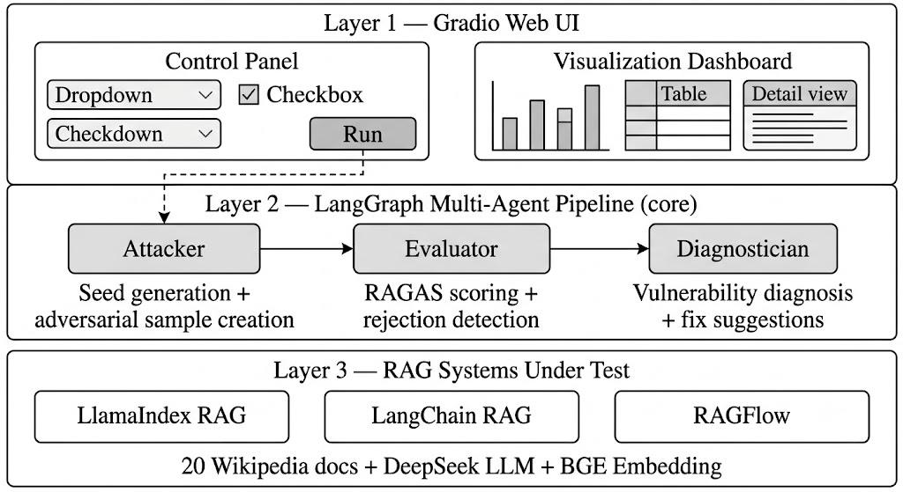
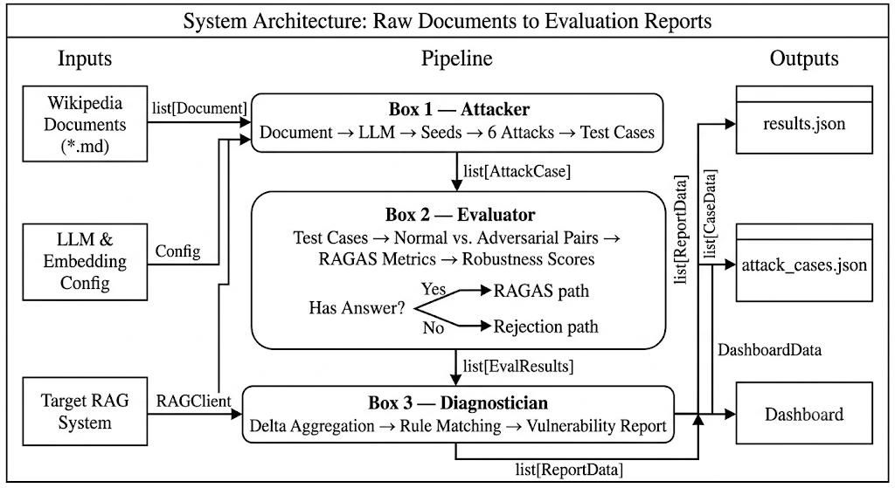
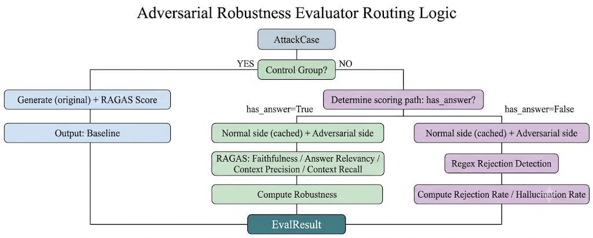
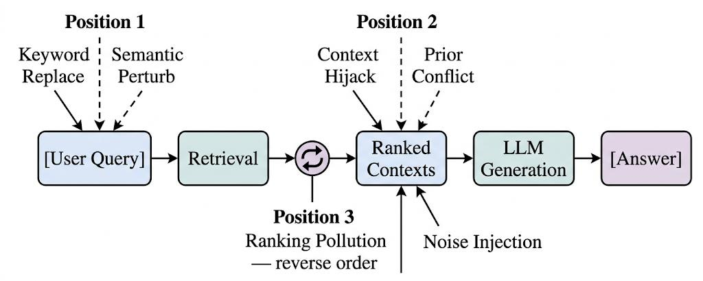

# Multi-Agent RAG Robustness Evaluation

[English](README.md) | [中文](README.zh-CN.md)

A three-agent pipeline that stress-tests an existing RAG system and reports **where** it
breaks, not just how well it scores.

Most RAG evaluation measures answer quality on clean inputs. This one measures
*degradation*. For every seed question it generates an adversarial twin, runs the clean and
the adversarial version through the target system, scores both with RAGAS, and treats the
gap as the signal. The pipeline then clusters those gaps by attack family and writes a
diagnosis: which layer failed, why, and what to change.

It evaluates **three real open-source RAG stacks** — LlamaIndex, LangChain and RAGFlow —
through one adapter interface, and the corpus it runs on is 20 Chinese Wikipedia articles
on climate and energy policy: dense, date-heavy, and full of near-duplicate terminology,
which is exactly the kind of text naive retrievers get wrong.



*Three layers: a Gradio UI for driving and viewing runs, a LangGraph pipeline holding the
three agents, and an adapter layer wrapping the RAG systems under test.*

## Key Features

| | |
|---|---|
| **Three-agent pipeline** | Attacker → Evaluator → Diagnostician, orchestrated as a LangGraph `StateGraph` with streamed step-by-step progress |
| **Six attack families** | two that rewrite the query, three that poison the context, one that reorders it |
| **Four-dimensional scoring** | RAGAS faithfulness / answer relevancy / context precision / context recall, run as a paired clean-vs-adversarial comparison |
| **Automatic case generation** | 20 seed questions × 7 conditions = 140 adversarial test cases, generated from the corpus with no hand-labelling |
| **Attribution, not just scores** | rule-based diagnosis per attack family, escalated to an LLM for a written root-cause analysis and concrete fix suggestions |
| **Framework-agnostic** | LlamaIndex, LangChain and RAGFlow behind one `BaseRAGAdapter`; adding a fourth means implementing two methods |
| **Two front ends** | argparse CLI for batch runs, Gradio web UI for interactive runs and live progress |

## Methodology

### The pipeline



**① Attacker.** Reads the document corpus, generates seed questions grounded in it, then
produces one adversarial variant per attack family per seed. Each case is tagged with what
it targets, which determines how it is replayed:

| `attack_target` | replay behaviour |
|---|---|
| `query` | perturbed query against the original retrieved contexts |
| `context` | original query against poisoned retrieved contexts |
| `ranking` | original query and contexts, in a reordered sequence |

**② Evaluator.** Runs the clean/adversarial pair through the target adapter and scores both
with the four RAGAS metrics. The per-metric delta, aggregated into a robustness score, is
what the report is built from. Cases where the system correctly *refuses* to answer are
counted separately rather than scored as failures.



*Each case is routed by whether it belongs to the control group and whether its seed has an
answer. Answerable cases go down the RAGAS path and yield a robustness score; unanswerable
ones go down the rejection path and yield a rejection and hallucination rate instead.*

**③ Diagnostician.** Clusters deltas by attack family, matches them against a rule table of
known failure signatures, then hands the failures to an LLM to write the root-cause
narrative and the fix. Rules and LLM disagreeing is itself informative; both are kept in
the output.

### The six attacks



*The six attacks map onto three positions in the RAG pipeline: before retrieval, between
retrieval and generation, and inside the ordering of the retrieved chunks.*

| Attack | Target | Idea |
|---|---|---|
| Keyword replacement | `query` | swap a term for a near-neighbour with different meaning, breaking lexical matching |
| Semantic perturbation | `query` | rewrite the question so it still sounds related but points elsewhere |
| Context hijack | `context` | inject authoritative-sounding text that contradicts the correct fact |
| Prior conflict | `context` | inject fabricated content *and* a fabricated citation for it |
| Noise injection | `context` | bury the evidence in a block of entirely unrelated text |
| Ranking pollution | `ranking` | keep every chunk, reorder them so the answer sinks |

### Robustness score

Each case yields a robustness score from the four metric deltas, plus a baseline score
(performance on the clean input) and a stability score. These separate two different
weaknesses: a system can be accurate but brittle (high baseline, low robustness) or bad at
both (low baseline, low robustness) — and the fix is different in each case.

## Experiments and Results

20 Chinese Wikipedia documents, 20 seed questions, 140 cases (20 seeds × 6 attacks
+ 20 clean controls).

| System | Robustness | Rating | Main weakness |
|---|:---:|:---:|---|
| **RAGFlow** | 0.833 | PASS | ranking |
| LangChain | 0.725 | WARN | ranking + generation layer |
| LlamaIndex | 0.699 | WARN | ranking + generation layer |

**The consistent finding is that ranking pollution hurts all three systems most.** None of
them re-check the order in which chunks are presented, so burying the right passage in a
pile of plausible ones degrades the answer more reliably than injecting contradictory text
does — the contradiction at least gets noticed sometimes.

Three self-contained HTML reports ship in [report/html/](report/html/), one per system:
overall scores, per-attack breakdown, per-seed drill-down, the generated adversarial
questions, and each side's answer with its scores. Per-case data is in
[data/experiment_140_cases.csv](data/experiment_140_cases.csv).

> The full write-up, system screenshots and per-attack analysis are in the 18-page
> technical report (`中文信息处理期末报告.pdf`), also in this repository.

## Tech Stack

| Layer | Choice |
|---|---|
| Agent orchestration | LangGraph `StateGraph` |
| Evaluation metrics | RAGAS 0.4 (faithfulness, answer relevancy, context precision, context recall) |
| Target systems | LlamaIndex, LangChain, RAGFlow |
| LLM | any OpenAI-compatible endpoint (developed against DeepSeek) |
| Embeddings | `BAAI/bge-small-zh-v1.5` via sentence-transformers, local by default |
| Retrieval utilities | rank-bm25 + jieba, ChromaDB |
| Web UI | Gradio |
| Reports | Jinja2 → standalone HTML |

## Installation and Usage

Requires Python 3.10+.

```bash
pip install -e .
```

The embedding model (~96 MB) downloads once on first use:

```bash
python -c "from sentence_transformers import SentenceTransformer; \
           SentenceTransformer('BAAI/bge-small-zh-v1.5')"
```

Configure:

```bash
cp .env.example .env
```

```ini
OPENAI_API_KEY=sk-your-key
OPENAI_BASE_URL=https://api.deepseek.com    # or any OpenAI-compatible endpoint
OPENAI_MODEL=deepseek-v4-flash
```

Run:

```bash
python -m src.main ui                       # web UI at http://127.0.0.1:7860
python -m src.main run --target llamaindex  # batch, results to stdout
python -m src.main run --target ragflow --output report/json/results.json
```

| Option | Values | Meaning |
|---|---|---|
| `--target` | `demo` / `llamaindex` / `langchain` / `ragflow` | system under test |
| `--seed` | path | seed question set (default `data/seed_queries.json`) |
| `--output` | path | write results here instead of stdout |

A quick first run that finishes in about a minute: pick **LlamaIndex**, **dev mode**, and
**faithfulness** only.

`src/scripts/` holds two standalone utilities run from the repository root:
`fetch_wiki.py` (pull the corpus from the Wikipedia API) and `llm_diagnose.py` (write an
LLM diagnosis for an existing results file).

## Repository Structure

```
.
├── src/
│   ├── main.py                  # CLI entry point (ui / run)
│   ├── app.py                   # Gradio web UI
│   ├── config.py                # settings, loaded from .env
│   ├── agents/                  # the three agents
│   ├── attacks/                 # six attack strategies
│   ├── adapters/                # RAG system adapters (LlamaIndex / LangChain / RAGFlow)
│   ├── metrics/                 # RAGAS runner, robustness and rejection metrics
│   ├── graph/                   # LangGraph orchestration
│   ├── services/                # embedding / generation / retrieval / ingestion
│   └── scripts/                 # standalone corpus and diagnosis utilities
├── data/
│   ├── documents/*.md           # 20 Chinese Wikipedia articles (CC BY-SA)
│   ├── seed_queries.json        # 20 seed questions with evidence spans
│   └── experiment_140_cases.csv # per-case scores for all 140 runs
├── report/html/                 # three standalone HTML evaluation reports
├── docs/figures/                # diagrams from the technical report
├── 系统手册.md                   # interface reference and extension guide
├── 中文信息处理期末报告.pdf        # 18-page technical report
├── pyproject.toml
└── .env.example
```

## Limitations

- **The corpus is small and narrow.** 20 articles, all climate/energy policy in Chinese.
  The absolute numbers should not be read as a general ranking of these three frameworks —
  they are a ranking *on this corpus*, and the corpus was chosen to be adversarial to
  retrieval, not representative.
- **RAGAS is used as a proxy for answer quality**, and it is itself LLM-judged. Score
  differences below a few points are within the judge's noise.
- **`context_recall` saturates at 1.0** by construction: seed questions are generated from
  the documents, so the ground truth is always retrievable. It is reported for
  completeness, not as a discriminating metric.
- **Retrieval-only evaluation.** The metrics judge retrieved context and generated answer;
  they say nothing about latency, cost, or behaviour under concurrent load.
- **The adversarial cases are LLM-generated** and therefore uneven in difficulty; a few
  attacks are much stronger than others, and the per-family averages partly reflect that.
- **Runs are serial**, roughly 30–60 s per case: a full 140-case sweep takes 40–60 minutes.

## Corpus and Attribution

The 20 documents in `data/documents/` are Chinese Wikipedia articles, retrieved through the
MediaWiki API by `src/scripts/fetch_wiki.py` and stored as Markdown. They are reused under
**[CC BY-SA 4.0](https://creativecommons.org/licenses/by-sa/4.0/)**; the source article for
each file is recorded in its front matter. This licence applies to those documents only,
not to the code in this repository.
